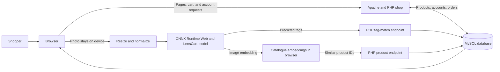

# LensCart

LensCart is a fashion shop with photo-based product search. Shoppers can browse and filter a sample catalogue, create an account, save items to a cart, and check out against a local MySQL database. A trained EfficientNet-B0 model predicts clothing type, colour, intended gender, and occasion from a photo.

## System flow



The uploaded photo is processed in the browser and is not sent to the server. For visual matching, the browser compares its image embedding with the catalogue embeddings, then asks PHP for the matching product records. Tag matching is available as a fallback.

## Run locally with XAMPP

You need XAMPP with Apache, PHP, MySQL or MariaDB, and the PDO MySQL extension.

1. Clone the repository and start Apache and MySQL in the XAMPP Control Panel.
2. In a terminal opened at the repository root, create a **new, empty** database named `lenscart_demo` and import the schema and sample data. These commands are for Command Prompt or the XAMPP Shell:

   ```bat
   C:\xampp\mysql\bin\mysql.exe -u root -e "CREATE DATABASE lenscart_demo CHARACTER SET utf8mb4"
   C:\xampp\mysql\bin\mysql.exe -u root lenscart_demo < site\sql\schema.sql
   C:\xampp\mysql\bin\mysql.exe -u root lenscart_demo < site\sql\seed.sql
   ```

   `schema.sql` drops and recreates LensCart tables, so use a fresh database rather than one containing data you want to keep.
3. In `site/inc/config.php`, set `DB_NAME` to `lenscart_demo`. Set `DB_USER` and `DB_PASS` if your local MySQL credentials differ from XAMPP defaults.
4. Copy the `site` folder into `C:\xampp\htdocs\lenscart`.
5. Open [http://localhost/lenscart/](http://localhost/lenscart/) in your browser.

The repository includes the trained checkpoint, browser model, catalogue vectors, and the sample images and model report. You do not need Python or the full training dataset to run the shop. The seeded prices, inventory, accounts, and order history are demonstration data.

## Main features

- Browse departments, search by name, and filter by type, colour, gender, occasion, or price.
- Upload a clothing photo for in-browser predictions, visual search, and model heat maps.
- View products, add them to the cart, register or sign in, and use the demo checkout flow.
- Use the admin pages to review sample sales and manage catalogue items.
- Read the model overview and evaluation results at `model.php`.

## Repository map

| Path | Contents |
| --- | --- |
| `site/` | PHP shop, browser interface, and SQL schema and sample data |
| `site/ai/` | ONNX model, labels, and product embeddings used for photo search |
| `models/best.pt` | Trained PyTorch checkpoint |
| `scripts/` | Training, evaluation, model export, and catalogue build scripts |
| `prepared/`, `results/` | Dataset split, label maps, metrics, and figures |

## Model artifacts

The PHP application does not run model inference on the server. `site/ai/lensnet.onnx` runs in the browser with ONNX Runtime Web; `models/best.pt` is the PyTorch checkpoint. The model has four classification heads and returns a 1,280-dimensional image embedding used for visual similarity. `scripts/export_onnx.py` exports the browser model and checks its outputs against PyTorch.

## License and attribution

The original LensCart software and project materials are licensed under the MIT License in [`LICENSE`](LICENSE). The included fashion catalogue subset comes from Param Aggarwal's [Fashion Product Images Dataset on Kaggle](https://www.kaggle.com/datasets/paramaggarwal/fashion-product-images-dataset), listed there under MIT. Bundled vendor components retain their own licenses: Chart.js (MIT), Lucide (ISC), and ONNX Runtime Web (MIT); their license texts are kept with the respective files under `site/vendor/` and `site/ai/vendor/`.
